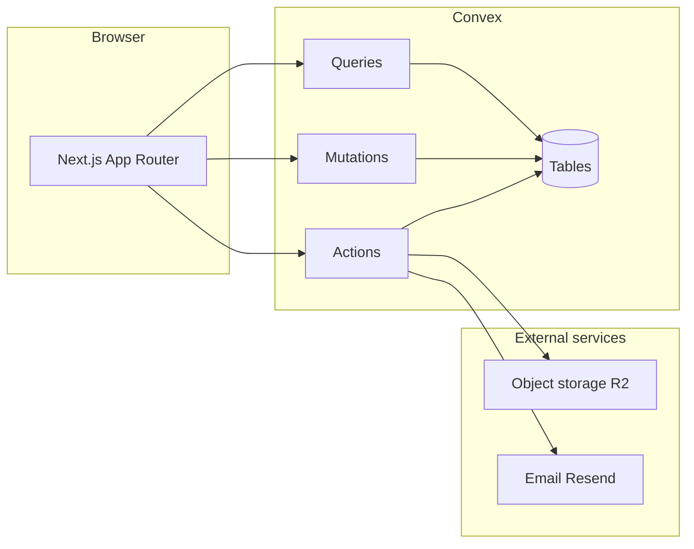

# System analysis — tcg-decks

This document is the **runtime and structural** view: what runs where, what data exists, and how major flows connect. Product intent lives in [PRODUCT_VISION.md](./PRODUCT_VISION.md).

## Context diagram (logical)

## Client application

- **Framework:** Next.js (App Router), React 19.
- **Routes:** Under `src/app/`. App-shell pages use the `(app)` group. **Game-scoped** pages live under `src/app/(app)/[game]/` (`gallery`, `decks`, `decks/[deckId]`, `collection`, `community/**`, `admin/sets|cards|formats|import`); **global** pages stay at `(app)/home`, `(app)/settings`, `(app)/teams`, `(app)/admin` (users, content, …), plus top-level `sign-in`, `sign-up`, `agent-login`, `auth/*` (handoff), `tour`, and `api`. User-visible URLs never contain the game: `src/middleware.ts` rewrites `/gallery` → `/{game}/gallery` (see [Hosts and games](#hosts-and-games)).
- **UI:** Component library patterns aligned with Shadcn/Radix-style primitives; non-trivial features should follow [component-architecture-playbook.md](./component-architecture-playbook.md).
- **Theme:** `ColorSchemeProvider` applies palette tokens via **`data-color-theme`** (preset id or `custom`), light/dark via the `dark` class and `color-scheme`, and chrome via **`data-chrome`** (`calm`, `expressive`, `holoterminal`, `bubblegum`, `darkmatter`). Details: [theme-and-chrome.md](./theme-and-chrome.md).
- **Game module:** Game-agnostic UI reads game behavior from `useGameModule()` (`src/games/game-context.tsx`; `GameProvider` is rendered by the root layout from request headers). Modules: shared/pure `shared/games/**` (`SHARED_GAME_MODULES`: deck rules, filters, text import/export, theme, brand) and client `src/games/**` (`CLIENT_GAME_MODULES`: `ui` components such as card rendering and symbols). UniVersus lives in `shared/games/uvs/**` + `src/games/uvs/**`; old `@/config/universus`, `@/lib/universus/*`, `@/components/universus/*` paths are re-export wrappers.
- **Feature folders:** Several surfaces use the playbook layout (`content.tsx`, `hook.ts`, `types.ts`) — for example gallery view, deck details view, community rankings view, and collection entry re-exports.

## Hosts and games

Contract: [multi-game.md](./multi-game.md).

- **Hosts** (`shared/hosts.ts`, `resolveHost`): `{game}.tcgdecks.gg` = game host; `tcgdecks.gg` = apex (game picker at `/`, sign-in/up, `/auth/*`, `/agent-login`, `/api/*`; other paths redirect to the default game host); anything else (`localhost:8090`, LAN IPs, Vercel previews) = standalone, which behaves as a single-game UniVersus site. Dev uses `*.tcgdecks.localhost:8090`. `uvsdecks.gg` 301s to `uvs.tcgdecks.gg`.
- **Routing:** `src/middleware.ts` wraps Convex Auth's middleware and delegates to the pure `routeRequest` (`src/lib/routing/route-request.ts`), setting `x-tcg-game` / `x-tcg-host-kind` request headers. Server code reads them with `getRequestGame()` (`src/lib/routing/request-game.ts`); the root layout derives metadata (brand/title per host) and `GameProvider` from it.
- **Auth handoff:** Convex Auth sessions are per host. Game hosts sign in via the apex: `/auth/handoff` on the apex mints a one-time code (`convex/authHandoff.ts`, `authHandoffCodes` table), the game host's `/auth/callback` redeems it through the `handoff` credentials provider in `convex/auth.ts`. A `tcgd_signed_in` hint cookie on `.{root}` drives silent SSO; sign-out on a game host signs out everywhere. Standalone hosts keep local sign-in.
- **Client storage:** IndexedDB `tcgdecks-{game}-cards|sets`; localStorage `tcgdecks:{game}:{key}` / `tcgdecks:{key}` (`src/lib/storage-keys.ts`), migrating legacy `uvs-decks*` keys on first read.

## Backend (Convex)

- **Data:** `convex/schema.ts` defines tables including users (beyond auth tables), sets, cards (with search indexes), a per-game **`cardFacetSnapshot`** row (rarities, types, set codes; `by_game_and_key`) rebuilt on admin release/import/clear, decks, collections, tier lists and items, community ranking snapshots, sessions, subscriptions, and engagement tables (likes, views, comments) as implemented. **Moderated binary uploads** use the `mediaAssets` table (`kind`: `team_logo` \| `profile_avatar`; `status` flows `pending` → `approved` \| `rejected` \| `needs_review`). Team logos: `api.mediaAssets.generateTeamLogoUploadUrl` / `submitTeamLogoUpload` → `internal.mediaAssetActions.runTeamLogoModeration` → `internal.mediaAssets.finalizeTeamLogoModeration`; `teams.logoAssetId` is set only when an asset is approved. Client-visible image URLs for that path come from `api.teams.logo.getTeamLogoPresentation`, which resolves `storage.getUrl` only for an **approved** asset on `logoAssetId` (not for pending or rejected rows). See `content-moderation-and-language-filter.md` §3.2 (planned doc, not yet in `docs/`).
- **Game scoping:** Game-scoped tables (`cards`, `sets`, `formats`, `cardLegality`, `setLegality`, `decks`, `collections`, `tierLists`, community ranking snapshots, `cardDataVersion`, `cardFacetSnapshot`, …) carry `game: v.optional(gameIdValidator)` with `by_game_*` indexes; public queries/mutations over them take a required `game` argument, and by-id reads return `null` for another game's doc. The field is optional until `migrations/backfillGameField` has run in production. Global tables (users, teams, settings, moderation) have no `game`. Helpers: `convex/lib/gameScope.ts`. Deck setup lives in `decks.setup` (per-game union), normalized by the game module.
- **API surface:** TypeScript modules under `convex/` expose queries, mutations, and actions consumed via generated `api`.
- **Auth:** `@convex-dev/auth` extends the schema with auth tables; app-specific `users` table stores profile and role fields used by the product. Local browser agents can obtain a normal password session via dev-only `/agent-login` (see [agent-onboarding.md](./agent-onboarding.md) §6); on a game host it signs in on the apex and hands off.

## Integrations

- **Storage:** `@convex-dev/r2` and AWS S3 client usage for card imagery and uploads (see codebase and Convex component config). The versioned static catalog is published per game at `catalog/{game}/v{n}.json.gz`; clients fall back to paginated Convex sync when the R2 fetch fails (e.g. CORS on a new origin).
- **Email:** `resend` for transactional email when wired.
- **YouTube (community media feed):** Manual video IDs live in `communityYoutubeCurations`. Admins can also watch creator channels (`communityYoutubeChannels`); Convex syncs each enabled channel’s uploads playlist (or an optional topic playlist) via **`playlistItems.list`** (and **`channels.list`** to resolve id/handle) and upserts the newest N matching videos into the same curation table (`source: "channel"`). Per-channel `titleIncludes` / `titleExcludes` keep mixed-game channels to UniVersus titles. Metadata is fetched server-side with **`videos.list`** (parts `snippet`, `contentDetails`, `statistics`), batched up to 50 IDs per request, and cached in `youtubeVideoMetadataCache` with `fetchedAt` and `publishedAt` (six-hour freshness target; Convex cron refreshes every two hours and re-syncs watched channels). Removed videos are recorded in `communityYoutubeFeedExclusions` so later channel pulls skip them. The public feed (`api.communityYoutube.getFeed`) sorts by `publishedAt` descending. The **Convex deployment environment variable** `YOUTUBE_DATA_API_KEY` must be set in the Convex dashboard (never `NEXT_PUBLIC_*`); it is read only inside Convex actions in `convex/communityYoutube.ts` and `convex/communityYoutubeChannels.ts`. Optional `UNIVERSUS_YOUTUBE_CHANNEL_ID` seeds the official channel onto the watchlist when missing. Restrict the Google API key to **YouTube Data API v3** in Google Cloud and monitor quota there. The community UI does not call Google APIs directly. Admin watchlist UI: `/admin/content/youtube`.

## Major data flows

1. **Gallery and search** — Client subscribes to Convex queries; card search uses Convex search indexes on derived fields such as `searchName`, `searchText`, `searchAll`. Stored `cards.text` is pipe-delimited abilities; reminder boxes and colon rules are in [universus/ability-text.md](./universus/ability-text.md).
2. **Deck build** — Deck documents store ordered card ids, quantities, layout metadata, and format fields; mutations persist edits; public decks are readable under index rules. `api.decks.duplicate` copies a viewable deck into a new private deck owned by the signed-in user (cards, layouts, format, and identity; not team, shares, or listing). Format validation uses `setLegality` (`rotatesOutAt` vs `Date.now()` in `convex/formats.ts`) and `cardLegality` (bans/restrictions honor `effectiveDate` in `convex/deckValidation.ts`). Admin: `/admin/formats/[key]` tabs; note [legality-dates.md](./implementation/notes/legality-dates.md).
3. **Collection** (planned) — Schema and Convex APIs exist for per-user card quantities; `/collection` currently renders a coming-soon placeholder rather than the full ownership UI.
4. **Tier lists and rankings** — Tier list documents hold tier definitions and metadata; items assign cards to lanes; scheduled or triggered jobs compute community rankings and snapshots (details in [features/community/TierListSystem.md](./features/community/TierListSystem.md)).
5. **Teams** — Membership, invites, hub surfaces, and team-scoped decks (see [teams-feature-implementation.md](./teams-feature-implementation.md)).

## Cross-cutting concerns

- **Authorization:** Mutations must enforce ownership or role checks consistent with Convex validators and auth identity.
- **Realtime:** Convex subscriptions drive live UI updates where used.
- **Performance:** Heavy aggregates lean on snapshot tables so read paths stay bounded. Client card **catalog** vs **formats/sets** use split React contexts in `CardDataProvider` so metadata consumers can avoid re-rendering on every catalog chunk; see `src/lib/universus/card-data-provider.tsx` (`card-data-hooks.md` is a planned doc). The local card catalog **IndexedDB** blob (CAT-001, one database per game) stores only gallery catalog rows; back faces load into memory after sync or cache read. If troubleshooting stale all-cards blobs, `clearCardCache(game)` in `src/lib/universus/card-store.ts` forces a full resync.

## Code structure expectations

- **Frontend features:** Prefer feature folders with a stable public path re-exporting `content.tsx`, colocated `hook.ts` / `context.tsx` when needed ([component-architecture-playbook.md](./component-architecture-playbook.md)).
- **Convex:** Split large domains into modules by concern when files grow; keep API paths stable when refactoring internals.

## See also

- [PRODUCT_VISION.md](./PRODUCT_VISION.md)
- [multi-game.md](./multi-game.md)
- [theme-chrome-guidelines.md](./theme-chrome-guidelines.md)
- [theme-and-chrome.md](./theme-and-chrome.md)

